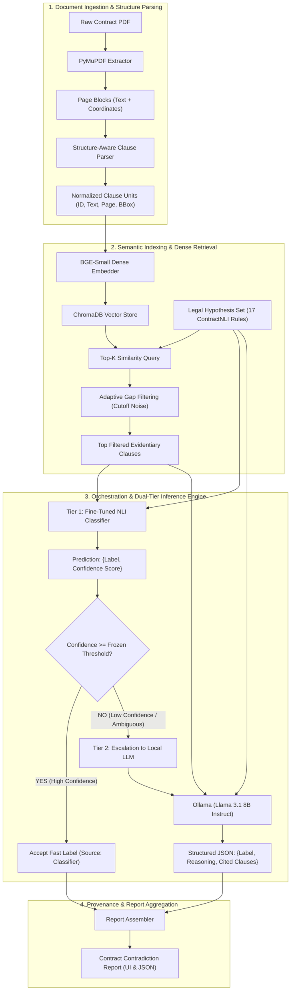

# EdgeLegal — Technical Architecture Document

**Target Audience:** Technical Product Managers (TPM), Engineering Leads, System Architects  
**Document Status:** Approved Architecture Reference  
**System Classification:** Local-First / Privacy-Preserving Legal Intelligence Engine  

---

## 1. Executive Summary & Product Vision

**EdgeLegal** is a privacy-first, offline-capable legal document intelligence system engineered to detect clause-level contradictions and compliance violations within enterprise legal agreements (e.g., Non-Disclosure Agreements, Master Services Agreements, Vendor Contracts).

### The Problem
Traditional legal AI architectures suffer from two core failure modes:
1. **Cloud-Dependent LLM Brute-Forcing:** Sending sensitive, confidential contracts to external cloud APIs poses severe data privacy, compliance (GDPR, SOC2, HIPAA), and IP leakage risks, while incurring prohibitive token costs and high latency (~3–8 seconds per clause check).
2. **Pure Small-Model Classifiers:** Standalone lightweight NLP/NLI models are fast and private, but fail on complex legal nuances, edge cases, multi-clause synthesis, and cannot generate human-readable legal reasoning for lawyers.

### The EdgeLegal Solution: Two-Tier Confidence Routing
EdgeLegal implements a **two-tier, confidence-routed local inference architecture**:
- **Tier 1 (Fast Triage):** A lightweight, fine-tuned Natural Language Inference (NLI) model running entirely on local CPU/GPU classifies premise-hypothesis pairs in milliseconds, generating a discrete label and a calibrated confidence score.
- **Tier 2 (Escalation LLM):** An orchestrated LangGraph agent evaluates the triage confidence against an empirically calibrated, frozen threshold. Only ambiguous or low-confidence cases are escalated to a quantized local LLM (e.g., Llama 3.1 8B via Ollama) for deep multi-clause legal reasoning and structured justification.
- **Result:** ~70–80% of contract clauses are resolved in milliseconds at zero marginal inference cost with 100% on-prem data isolation, reserving heavy LLM compute only for the 20–30% of ambiguous, high-risk clauses.

```
+-------------------------------------------------------------------------------+
|                             EDGELEGAL ARCHITECTURE                            |
|                                                                               |
|  +--------------------+     +---------------------+     +------------------+  |
|  |   Contract PDF     | --> |   Clause Parser     | --> | Dense Retrieval  |  |
|  | (PyMuPDF Ingest)   |     | (Heading/BBox Split)|     | (BGE / ChromaDB) |  |
|  +--------------------+     +---------------------+     +------------------+  |
|                                                                   |           |
|                                                                   v           |
|                                                          +-----------------+  |
|                                                          | Adaptive Gap    |  |
|                                                          | Filter (Top-K)  |  |
|                                                          +-----------------+  |
|                                                                   |           |
|                                                                   v           |
|                                                          +-----------------+  |
|                                                          | Tier 1: NLI     |  |
|                                                          | Triage Model    |  |
|                                                          +-----------------+  |
|                                                                   |           |
|                                                                   v           |
|                                                          +-----------------+  |
|                                                          | LangGraph Agent |  |
|                                                          | Router Decision |  |
|                                                          +--------+--------+  |
|                                                                   |           |
|                                       +---------------------------+           |
|                                       |                                       |
|                       Confidence >= Threshold?                                |
|                               /               \                               |
|                       YES    /                 \   NO                         |
|                             v                   v                             |
|                    +------------------+   +-------------------+               |
|                    | Accept Triage    |   | Tier 2: Local LLM |               |
|                    | Label Directly   |   | (Ollama Reasoning)|               |
|                    +--------+---------+   +---------+---------+               |
|                             |                       |                         |
|                             +-----------> + <-------+                         |
|                                           |                                   |
|                                           v                                   |
|                                 +--------------------+                        |
|                                 | Contradiction      |                        |
|                                 | Report Generator   |                        |
|                                 +--------------------+                        |
+-------------------------------------------------------------------------------+
```

---

## 2. Core Architectural Principles & NFRs

1. **Strict Single Responsibility Principle (SRP):** Each system component handles exactly one concern. The parser segments; the embedder transforms text into vectors; the triage model predicts; the agent routes; the LLM reasons; the report generator formats. Boundaries never blur.
2. **Zero Cloud Egress (100% Local / Air-Gapped):** All ingestion, embedding, vector search, classification, and generative reasoning execute on local client hardware or sovereign private VPCs. No contract text or metadata ever touches third-party external networks.
3. **Calibrated Confidence Gating:** Routing decisions rely on statistically verified Expected Calibration Error (ECE) and fixed validation thresholds rather than arbitrary heuristic cutoff scores.
4. **Full Evidentiary Provenance:** Every contradiction finding must map back to exact page numbers, visual bounding boxes (BBoxes), source clause text, classification source (Triage vs. LLM), and semantic reasoning chains.

---

## 3. End-to-End System Subsystems



---

## 4. Detailed Component Specifications

### 4.1. Document Ingestion & Clause Segmentation Engine
- **Purpose:** Ingest unstructured legal PDFs and convert them into retrievable, boundary-accurate clause units without losing page coordinates.
- **Key Responsibilities:**
  - Extracts text blocks alongside page indexes and bounding boxes (`bbox`) using PyMuPDF (`fitz`).
  - Implements legal structure-aware segmentation recognizing numbered sections, sub-clauses (`1.1`, `(a)`, `(iv)`), all-caps headers (`CONFIDENTIALITY`, `INDEMNIFICATION`), and indentation structures.
  - Maintains parent-child hierarchical section headers for contextual clarity.
- **Architectural Boundary:** Does **not** perform semantic filtering or predict any legal labels.

### 4.2. Vector Store & Adaptive Retrieval Subsystem
- **Purpose:** Store clause embeddings and retrieve the most relevant contract sections for any given legal hypothesis.
- **Technology:** `BAAI/bge-small-en` (384-dimensional dense vectors) + `ChromaDB` embedded vector store.
- **Adaptive Gap Filtering Mechanism:**
  - Standard top-$k$ retrieval often introduces noise by pulling weakly relevant clauses just to satisfy $k=5$.
  - EdgeLegal applies an **Adaptive Gap Filter**:
    1. Retrieve candidates ranked by cosine distance.
    2. Rank-1 candidate is always preserved.
    3. If the relative semantic distance between candidate $i$ and candidate $i+1$ exceeds the relative gap threshold (default 15%), all subsequent candidates are discarded.
  - **Outcome:** Eliminates downstream context pollution and reduces inference compute on irrelevant clauses.

### 4.3. Tier 1: Specialized NLI Triage Model
- **Purpose:** Provide ultra-fast, edge-executable classification on clause-hypothesis pairs.
- **Architecture:** Lightweight Transformer (fine-tuned `DeBERTa-v3` / `LegalBERT` for Natural Language Inference).
- **Output Space:** 3-class probability distribution:
  1. `Entailment` (Contract clause supports / complies with the hypothesis).
  2. `Contradiction` (Contract clause directly conflicts with the hypothesis).
  3. `NotMentioned` (Contract clause is silent or irrelevant to the hypothesis).
- **Confidence Calibration:** Applies temperature scaling and evaluates Expected Calibration Error (ECE) during validation. This guarantees that a 0.85 confidence score corresponds to true ~85% empirical accuracy.
- **Architectural Boundary:** Predicts labels and output probabilities only. Does **not** produce natural language explanations.

### 4.4. Orchestration & Agent Routing (LangGraph State Machine)
- **Purpose:** Enforce deterministic, stateful workflow routing based on confidence boundaries.
- **Graph State Schema:**
  - `document_id`: Active contract identifier.
  - `hypothesis`: Target legal standard / compliance check.
  - `retrieved_clauses`: Gap-filtered evidentiary candidates.
  - `triage_label`: Prediction from Tier 1 model.
  - `triage_confidence`: Calibrated probability score from Tier 1.
  - `routing_decision`: `"accept"` vs. `"escalate"`.
  - `final_label`: Resolved legal status.
  - `reasoning_text`: Explanation string (null if accepted from classifier, populated if escalated).
  - `source_engine`: `"classifier"` | `"llm"`.
- **Decision Rule:**
  $$\text{Action} = \begin{cases} \text{Accept Triage Label} & \text{if } \text{Confidence} \ge \tau_{\text{frozen}} \\ \text{Escalate to Local LLM} & \text{if } \text{Confidence} < \tau_{\text{frozen}} \end{cases}$$
  *Note: $\tau_{\text{frozen}}$ is determined during validation tuning and frozen for production runs.*

### 4.5. Tier 2: Heavyweight Local LLM Reasoning Engine
- **Purpose:** Perform complex legal reasoning, resolve multi-clause dependencies, and articulate natural language explanations for escalated cases.
- **Technology:** Local `Ollama` runtime hosting quantized instruction models (e.g., `llama3.1:8b-instruct-q4_K_M` or `mistral:7b-instruct`).
- **Structured Output Protocol:**
  - Enforces JSON schema response format:
    ```json
    {
      "label": "Contradiction | Entailment | NotMentioned",
      "confidence_assessment": "High | Medium | Low",
      "cited_clauses": ["Clause_12", "Clause_14"],
      "reasoning": "Clause 12 states a 2-year confidentiality duration, which directly contradicts the 5-year requirement asserted in the hypothesis."
    }
    ```
- **Architectural Boundary:** Invoked strictly on escalated pairs. Does **not** process routine, high-confidence clauses.

### 4.6. Report Generation & Provenance Engine
- **Purpose:** Consolidate discrete clause findings into an executive-ready compliance audit report.
- **Deliverables:**
  - Interactive Web Dashboard for legal review.
  - Machine-readable JSON contract audit trace.
  - Exportable PDF / Markdown compliance summaries with linked clause citations and bounding boxes for visual verification in the PDF viewer.

---

## 5. System Latency & Performance Profile

| Processing Stage | Target Latency (p50) | Target Latency (p95) | Compute Requirement | Execution Mode |
|---|---|---|---|---|
| PDF Text & Layout Extraction | 150 ms / doc | 400 ms / doc | CPU (PyMuPDF) | Batch Synchronous |
| Clause Boundary Segmentation | 50 ms / doc | 120 ms / doc | CPU (Heuristic / Regex) | In-Memory |
| Dense Embedding (All Clauses) | 200 ms / doc | 500 ms / doc | CPU / Metal / CUDA | Batched Vectorization |
| ChromaDB Top-K Query + Gap Filter | 15 ms / query | 35 ms / query | Memory / Disk | Local Vector Search |
| **Tier 1 NLI Triage Model** | **8 ms / pair** | **25 ms / pair** | CPU or Small GPU | Synchronous Forward Pass |
| **Tier 2 Local LLM Escalation** | **1.8 s / pair** | **4.2 s / pair** | GPU / VRAM (Ollama) | Async Stream / Call |
| Report Synthesis | 10 ms / report | 25 ms / report | CPU | In-Memory Aggregation |

### Expected Cost & Throughput Impact
- In a contract evaluated against 17 standard NDA hypotheses (17 evaluation cycles):
  - **Un-routed Full LLM Baseline:** $17 \times 2.5\text{s} \approx \mathbf{42.5\text{ seconds}}$
  - **EdgeLegal Confidence-Routed:** $(14 \times 0.015\text{s}) + (3 \times 2.5\text{s}) \approx \mathbf{7.7\text{ seconds}}$ ($\mathbf{82\% \text{ reduction in review latency}}$).

---

## 6. Model Training, Calibration & Evaluation Framework

```
                 OFFLINE / LAB EXPERIMENTATION & TUNING
  +------------------------------------------------------------------+
  |  ContractNLI Dataset (Train / Val Splits)                        |
  |    -> Fine-Tune DeBERTa-v3 on Legal NLI Pairs                    |
  |    -> Validation Loss & Macro-F1 Optimization                    |
  |    -> Expected Calibration Error (ECE) Reliability Sweep         |
  |    -> Select and FREEZE Optimal Confidence Threshold (τ)         |
  +------------------------------------------------------------------+
                                  |
                                  v
                    PRODUCTION INFERENCE (HELD-OUT TEST)
  +------------------------------------------------------------------+
  |  Frozen Threshold (τ) Locked                                     |
  |  -> Run Pipeline Modes (A: No Triage, B: Pretrained, C: Tuned)   |
  |  -> Evaluate Accuracy, Missed Detections, False Positives        |
  |  -> Compute McNemar Statistical Significance Between Configs     |
  +------------------------------------------------------------------+
```

### 6.1. Confidence Threshold Calibration Policy
1. **Validation-Only Tuning:** The routing threshold $\tau$ is computed exclusively on the validation split. It is strictly frozen prior to running on held-out test data to prevent data leakage.
2. **Reliability Metrics:** Evaluated against **Expected Calibration Error (ECE)** and class-weighted **Macro-F1** (addressing the heavy class imbalance of legal non-infringement vs. contradiction).

### 6.2. Comparative Experiment Configurations (A/B/C Testing)
To benchmark ROI and classification accuracy, EdgeLegal supports three runtime configurations:
- **Configuration A (LLM Only / No Triage):** Every clause-hypothesis pair bypasses triage and is dispatched directly to the Tier 2 LLM. Serves as the upper-bound reasoning baseline.
- **Configuration B (Zero-Shot / Pretrained Triage):** Routing is driven by an off-the-shelf, out-of-domain NLI checkpoint.
- **Configuration C (Fine-Tuned EdgeLegal Triage):** Routing is driven by the domain-adapted legal NLI triage model with calibrated confidence gating.
- **Statistical Significance:** Pipeline comparative results are validated using **McNemar's Paired Test** ($p < 0.05$) to mathematically prove performance gains over non-tiered architectures.

---

## 7. Component Boundary Matrix (RACI / Separation of Concerns)

| System Component | Does (Allowed Responsibilities) | Does NOT Do (Forbidden Operations) |
|---|---|---|
| **PDF Extractor** | Raw text extraction, coordinate capture, bounding box tracking, page metadata assignment. | Clause boundary splitting, semantic filtering, label inference. |
| **Clause Parser** | Structural section identification, clause chunk segmentation, header association. | Vector embedding, semantic relevance filtering, classification. |
| **Embedder & Vector Store** | Dense vectorization (`bge-small-en`), cosine indexing, adaptive gap filtering. | Model training, entailment prediction, decision routing. |
| **Tier 1 Triage Classifier** | Fast NLI inference, 3-class probabilities, confidence generation. | Natural language reasoning, explanation generation, workflow routing. |
| **LangGraph Orchestrator** | State management, threshold evaluation, execution branch dispatching. | Model weight computation, direct text generation, data normalization. |
| **Tier 2 Local LLM** | Deep legal reasoning, synthetic multi-clause deduction, structured JSON explanations. | Ingesting raw un-segmented PDFs, processing non-escalated pairs. |
| **Report Generator** | JSON assembly, markdown/PDF formatting, UI payload dispatch. | Algorithmic scoring, label overrides, confidence alteration. |

---

## 8. Security, Governance & Privacy Architecture

- **Air-Gapped Operation:** EdgeLegal runs without internet access. Both embedding and generation weights reside in local disk caches (`./models` and local Ollama storage).
- **Data Retention & Ephemeral State:** Ingested documents and intermediate vector embeddings are isolated by `session_id` and can be configured for automatic in-memory teardown after report generation.
- **Deterministic Audit Trail:** Every report preserves the exact checkpoint hashes, temperature settings, threshold values, and raw classifier confidences to ensure compliance audits can reproduce findings deterministically.

---

## 9. Product Roadmap & Strategic Extension Points

1. **Multi-Document Cross-Agreement Contradictions:** Extending graph orchestration to compare clauses across related contracts (e.g., Main Agreement vs. Statement of Work vs. Master Services Agreement).
2. **Interactive Visual Bounding Box Anchoring:** Deep-linking frontend report citations to high-resolution bounding box highlights in the embedded PDF canvas viewer.
3. **Continuous Active Learning Feedback Loop:** Enabling legal counsel to flag false positives / missed contradictions, staging anonymized correction pairs for scheduled local LoRA fine-tuning cycles.
4. **Pluggable Local Model Backends:** Modular support for enterprise-grade quantized models (e.g., Llama 3.1 70B for high-spec workstations, Mistral Nemo, or Qwen-2.5-Coder for structured reasoning).
